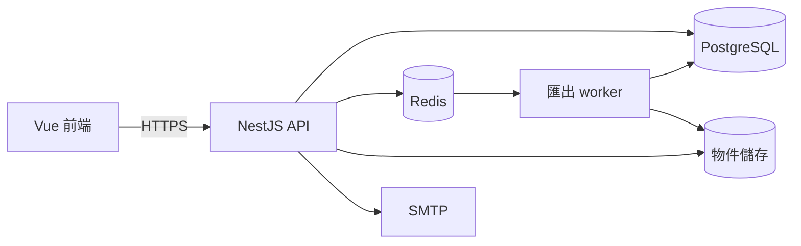

# 架構

## 元件



## 模組與依賴方向

業務模組依賴平台模組，平台模組不依賴業務模組。

| 模組 | 負責 | 可以依賴 |
|---|---|---|
| `common`、`config`、`prisma` | 錯誤格式、請求上下文、log、TenantDb | — |
| `auth` | 註冊、登入、token | common、prisma |
| `tenancy` | 權限矩陣、AccessGuard、`/me` | auth、common、prisma |
| `members` | 成員、邀請、寄信 | auth、audit、billing |
| `audit` | 稽核紀錄 | common、prisma |
| `billing` | 方案、用量、每租戶限流 | common、prisma |
| `projects`、`tags`、`files`、`exports` | 業務 | 以上全部 |

## 一個帶租戶的請求

```mermaid
sequenceDiagram
  participant C as 前端
  participant M as RequestIdMiddleware
  participant G as AccessGuard
  participant S as Service
  participant D as TenantDb
  participant P as PostgreSQL
  C->>M: GET /api/v1/projects（Bearer token）
  M->>G: ALS 開一個 { requestId }
  G->>G: 驗 JWT，取 sub、tid 放進 ALS
  G->>D: 查 membership（角色以資料庫為準）
  G->>S: 權限符合
  S->>D: project.findMany()
  D->>P: BEGIN; set_config(app.tenant_id); SELECT … WHERE tenant_id = …; COMMIT
  P-->>C: 只有這個租戶的資料（RLS 再擋一次）
```
