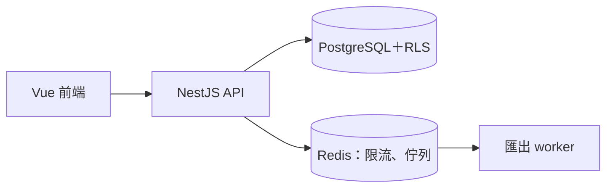

# My SaaS：多租戶後台

一個團隊協作 SaaS 的後端：多租戶、成員與角色、稽核、檔案、背景匯出、方案上限。業務示範模組是 projects 與 tags。

## Demo

（部署後填上網址與示範帳號；示範資料不含真實個資）

## 架構

見 [docs/architecture.md](docs/architecture.md)。



## 功能

- 平台：註冊與登入（refresh token 輪替）、租戶隔離（Prisma extension＋RLS）、成員與邀請、RBAC、稽核紀錄、檔案上傳、背景匯出、方案上限與每租戶限流、OpenAPI、結構化 log 與健康檢查
- 業務：projects、tags

## 設計決定

| ADR | 決定 |
|---|---|
| [0001](docs/adr/0001-tenant-isolation.md) | 共用資料表＋tenant_id |
| [0002](docs/adr/0002-rls-defense-in-depth.md) | Prisma extension 與 RLS 兩道防線 |
| [0003](docs/adr/0003-token-design.md) | access token＋輪替的 refresh token |
| [0004](docs/adr/0004-file-storage.md) | 檔案經過 API 上傳 |
| [0005](docs/adr/0005-background-jobs.md) | BullMQ，worker 跟 API 同程序 |
| [0006](docs/adr/0006-plans-and-rate-limits.md) | 方案上限與每租戶限流 |
| [0007](docs/adr/0007-observability.md) | 結構化 log 與健康檢查 |

## 如何執行

```bash
cp .env.example .env
npm run dev:up
npx prisma migrate deploy && npm run start:dev   # http://localhost:3100，文件在 /docs
```

## 測試

`npm test`：單元測試與 E2E（含跨租戶測試 `test/tenant-isolation.e2e-spec.ts`）。

## 已知限制與下一步

- 沒有接金流（方案升級是模擬的）。
- 檔案存本機磁碟；正式環境要換 S3 相容儲存。
- worker 跟 API 同一個程序。
